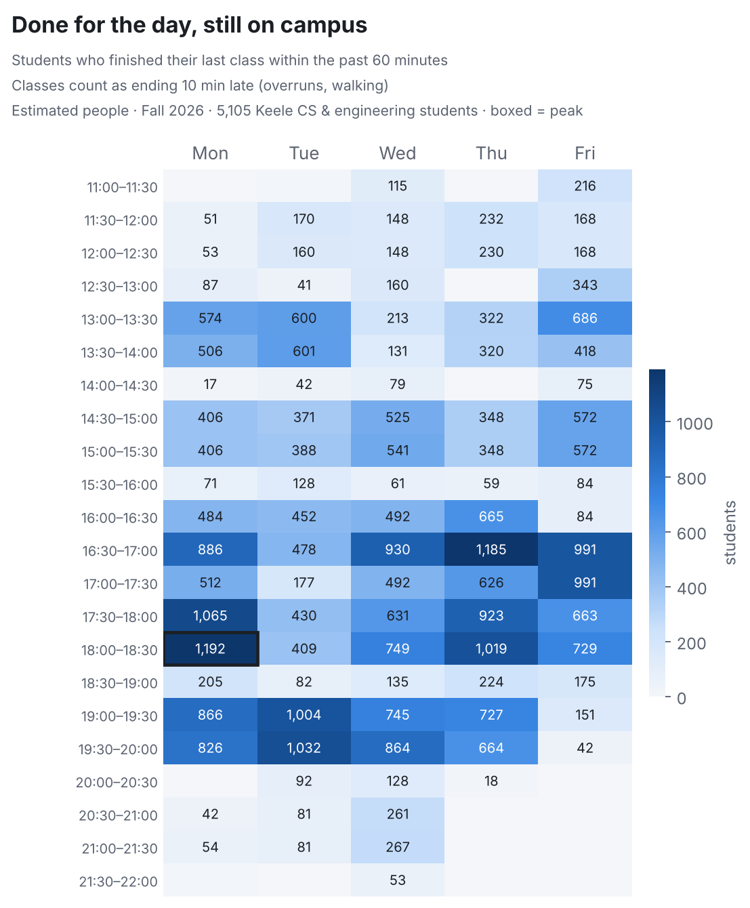

# YorkU event timing

**When are York University CS and engineering students done with class, but still on campus?**

Student clubs at York (this started with CSHub and GDG on Campus) keep running into the same question: when should we hold an event so the most people can actually come? This repo answers it from public schedule data, not guesswork. It combines the Fall/Winter 2026-27 timetables, the 2026-27 degree checklists and OIPA enrolment counts. A Monte Carlo model then builds plausible weekly timetables for about 5,100 Keele students across 11 programs.



## Key results (Fall 2026, Keele)

Estimated students who have **finished their last required class and are still on campus** (assuming they stay about 60 minutes after it):

| Rank | Window | Done for the day | Still in class |
|---|---|---|---|
| 1 | Mon 18:00–18:30 | ~1,190 | ~980 |
| 2 | Thu 16:30–17:00 | ~1,185 | ~1,550 |
| 3 | Mon 17:30–18:00 | ~1,065 | ~1,140 |
| 4 | Tue 19:30–20:00 | ~1,030 | ~560 |
| 5 | Thu 18:00–18:30 | ~1,020 | ~740 |

If students only stay 30 minutes, the best windows become Mon 17:30, Fri 16:30 and Tue 19:00. The notebook has the full ranked tables, the 30-minute version and a breakdown by program and year.

## How it works

1. **Parse the timetables** into one row per section, meeting and weekday (lectures, labs and tutorials).
2. **Parse the degree checklists** into the courses each program requires, by year and recommended term.
3. **Simulate students.** For each program and year, sample 400 students. Each one picks one section per course and one lab or tutorial group, avoids clashes the way a real student would when registering, and gets a 10-minute buffer after every class.
4. **Track each student's day:** in class, free between classes, *done for the day* (after their last class, still around) or not on campus.
5. **Weight by headcount.** Scale each cohort by its OIPA Fall 2025 headcount, split across years using OIPA's first-year retention rate. The Year 2→3 loss is assumed to be half the Year 1→2 loss, following AIR's study of later-year retention.

The full walkthrough, with every chart and assumption, is in [`event_timing_walkthrough.ipynb`](event_timing_walkthrough.ipynb). Outputs are already rendered, so you can read it on GitHub without running anything. The interactive hover charts are saved as standalone pages in [`figures/`](figures/).

## Quickstart

```bash
git clone <this-repo-url> && cd yorku-event-timing
pip install -r requirements.txt
jupyter lab event_timing_walkthrough.ipynb
```

## Repository layout

| Path | What it is |
|---|---|
| `event_timing_walkthrough.ipynb` | The walkthrough: data, model, results, caveats. Start here. |
| `src/campus_model.py` | The schedule model: section choice, clash avoidance, Monte Carlo cohorts |
| `src/parse_timetable.py` | Saved York timetable page (`.html`) → meetings CSV |
| `src/parse_checklists.py` | Folder of Lassonde degree checklists (`.xlsx`) → requirements CSV |
| `src/still_on_campus_charts.py` | Builds the "done for the day" and "not on campus" heatmaps (60 and 30 min) |
| `data/york_fw2026_meetings.csv` | Lassonde and Science timetables merged, with Markham-taught sections removed |
| `data/requirements_all.csv` | Required courses per program and year (the `source` column names the checklist file each row came from) |
| `data/headcount_keele_fall2025.csv` | Fall 2025-26 headcount per program, Keele-Glendon campus |
| `figures/` | Every chart the notebook and the script produce |

## Data sources

All inputs are York University publications. This is an independent student project, not affiliated with or endorsed by York University.

| # | Dataset | Source | Used for | File |
|---|---|---|---|---|
| 1 | **Course timetables, Fall/Winter 2026-27**: Lassonde School of Engineering (`FW2026LE`) and Faculty of Science (`FW2026SC`) | York University, Office of the University Registrar. *York Courses Web Site*, "View Active Course Timetables by Faculty." <https://w2prod.sis.yorku.ca/Apps/WebObjects/cdm> (retrieved October 2026, signed in with Passport York) | Every section's day, time, duration, campus, room and meeting type | `data/york_fw2026_meetings.csv` |
| 2 | **2026-27 degree checklists** for Lassonde programs (BEng, BSc/BA Computer Science, Cybersecurity, Digital Media, Earth & Atmospheric Science) | Lassonde School of Engineering, *2026-2027 Program Checklists*. <https://lassonde.yorku.ca/student-life/2026-2027-program-checklists> | Required courses by program, year and term | `data/requirements_all.csv` |
| 3 | **Data Science, BSc Honours** program requirements | York University, *Undergraduate Calendar 2026-2027*, Faculty of Science. <https://2026-2027.calendars.students.yorku.ca/> (entered by hand; year inferred from the course number) | Required courses for Data Science, which has no Lassonde checklist | `data/requirements_all.csv` |
| 4 | **Undergraduate Student Headcount**, Fall 2025-26, Keele-Glendon campus, by program | York University, Office of Institutional Planning & Analysis (OIPA), *Quick Facts* dashboards. <https://www.yorku.ca/oipa/quick-facts/> (read by hand from the Tableau dashboard) | Number of students per program | `data/headcount_keele_fall2025.csv` |
| 5 | **Undergraduate Retention Rate**: 89.9% of the 2024 entering cohort returned for Year 2 | OIPA, *Quick Facts*, Undergraduate Retention Rate dashboard. <https://www.yorku.ca/oipa/quick-facts/> | Splitting program headcounts across years | constant in the notebook (section 8) |
| 6 | **Retention after the first year**: across 17 US four-year institutions (2015–16 entering cohort), 23% of students left after Year 1, another 10% after Year 2 ("about half as many"), and another 3% after Year 3 | Pitcher, M., & Parsons, K. (2023). *More to the Retention Story: Exploring Second- to Third-Year Retention at 4-Year Colleges and Universities*. American Institutes for Research. <https://www.air.org/sites/default/files/2023-08/AIR-More-to-the-Retention-Story-July-2023-Final.pdf> | Basis for assuming the Year 2→3 loss is half the Year 1→2 loss | assumption in the notebook (section 8) |

**What was changed in the data.** The timetable CSV keeps only scheduling fields. Instructor names, course notes and catalogue numbers were removed before publication because the model doesn't use them. Markham-campus sections are excluded. Elective pools and general-education placeholders in the checklists are skipped on purpose, because they don't tie a student to a specific time.

## Rebuild from fresh sources

```bash
# 1. Timetables: save "View Active Course Timetables by Faculty" pages while signed in to Passport York
python src/parse_timetable.py FW2026LE.html le.csv
python src/parse_timetable.py FW2026SC.html sc.csv
python -c "import pandas as pd; a=pd.read_csv('le.csv',dtype=str); b=pd.read_csv('sc.csv',dtype=str); \
a.insert(0,'source','FW2026LE'); b.insert(0,'source','FW2026SC'); d=pd.concat([a,b]); \
d=d[d.campus!='Markham'].drop(columns=['instructors','notes','cat_no']); d['course_code']=d.dept+' '+d.course; \
d.to_csv('data/york_fw2026_meetings.csv',index=False)"

# 2. Degree checklists: download the .xlsx files into checklists/, then re-append the Data Science rows (source 3)
python src/parse_checklists.py checklists/ data/requirements_all.csv

# 3. Re-run everything
jupyter nbconvert --to notebook --execute --inplace event_timing_walkthrough.ipynb
python src/still_on_campus_charts.py
```

## Limitations

- **Required courses only.** Electives and breadth courses aren't modelled, so real students are on campus *more* than shown, and their days end later. Upper years are mostly electives and look "thin."
- **Equal section weights.** Enrolment per section isn't public, so a 300-seat section and a 30-seat one are treated as equally likely.
- **Per-year headcounts are estimates.** They combine one York-wide first-year retention rate with later-year attrition patterns from US institutions (source 6), not program-level York data. The model also assumes no loss after Year 3, while AIR found about 3% more of the original cohort leaving between Years 3 and 4.
- **Behaviour is assumed.** "Stays 60 (or 30) minutes after the last class" is an assumption, not a measurement.
- **Keele only.** Faculties outside Lassonde and Science (AMPD, LA&PS, Schulich) aren't in the timetable data, so courses those faculties teach are invisible.

The notebook (section 9) discusses each of these in more detail.

## Contributing

Issues and pull requests are welcome, especially more timetables (other faculties, Winter term), real attendance data from past events, and ports of this analysis to other universities. See the [issues](../../issues) tab for open tasks.

## License

The code is released under the [MIT License](LICENSE). The data in `data/` comes from the York University sources cited above and remains subject to their terms.
